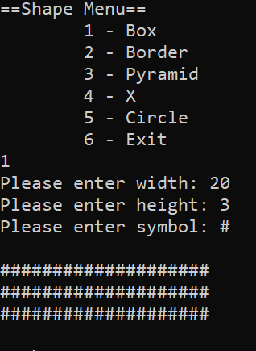
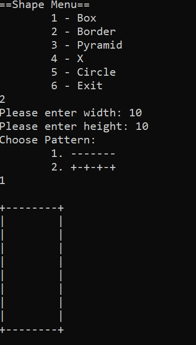
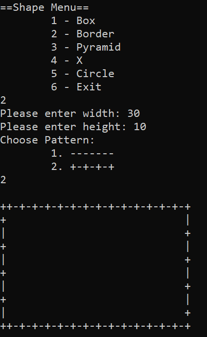
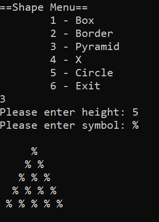
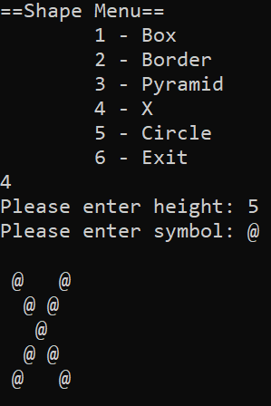
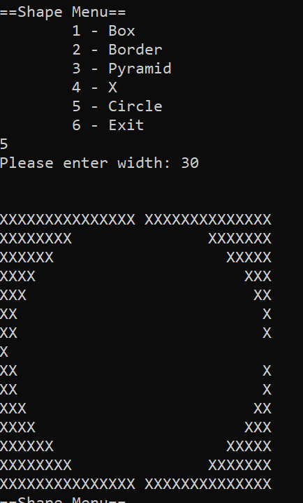

# Homework 2: Loops and Menu-Driven Shape Printing

## Due 10/20/26

## Description:

This homework is centered on nested loops, conditional statements inside loops, and menu-driven programs. You will build a single program that prints several shapes to the console based on user input. Each shape is shown in an image. You are not given the steps to build each shape, so you will need to study the images carefully, find the pattern, and turn it into loops and conditions.


## How to Hand In

- Follow instructions to produce the following file:
```
/
└── CS108-HW2-Lastname/
    └── shapes.c
```

- With the file above in a folder, zip it and name it:
	- CS108-HW2-Lastname.zip
	- Replace "Lastname" with your last name
- Submit the zip file to Brightspace


For every shape below, your output must match the provided image, including spacing, blank lines, and which characters appear where. If your output differs from the image, it is incorrect, even if it looks similar. Test your program with several different inputs, not just the ones shown in the images.

## Section 1: The Menu

Your program should display the following menu, read the user's choice, and run the matching shape. After a shape is printed, the menu is shown again. The program only ends when the user chooses Exit.

```
==Shape Menu==
	1 - Box
	2 - Border
	3 - Pyramid
	4 - X
	5 - Circle
	6 - Exit
```

**Your program should:**

- Use a loop so the menu repeats until the user picks option 6
- Use a `switch` statement (or an if-else chain) to handle each option
- Print a blank line after each shape, as shown in the images

**Grading criteria:** Does the menu display correctly, repeat after each shape, and exit only on option 6?


## Section 2: Shapes

Each shape below is its own menu option. For each one, prompt the user for exactly the inputs listed, in the order listed. Every prompt must clearly state what is expected (for example, "Please enter width: ").

### Option 1: Box

**Inputs (in this order):**

- Width (integer)
- Height (integer)
- Symbol (a single character)

**Output:** A filled rectangle of the given symbol with the given width and height.




**Grading criteria:** Does the output match the image for any width, height, and symbol?

### Option 2: Border

**Inputs (in this order):**

- Width (integer)
- Height (integer)
- Pattern (1 or 2). Show the user both pattern choices before they pick:
```
Choose Pattern:
	1. -------
	2. +-+-+-+
```

**Output:** A hollow rectangle with a border drawn in the chosen pattern. The corners and edges follow the rules shown in the images.





Pay close attention to what happens at the corners and how the pattern behaves along the top, bottom, left, and right edges.

**Grading criteria:** Does the output match the images for both patterns across different sizes?

### Option 3: Pyramid

**Inputs (in this order):**

- Height (integer)
- Symbol (a single character)

**Output:** A pyramid of the given symbol with the given number of rows.



Pay close attention to the spacing in front of and between symbols on each row.

**Grading criteria:** Does the output match the image for any height and symbol?

### Option 4: X

**Inputs (in this order):**

- Height (integer)
- Symbol (a single character)

**Output:** An X made of the given symbol, with the given height.



 Your program will only be tested with the kinds of heights shown in the image, so state clearly in your prompt which heights are acceptable.

**Grading criteria:** Does the output match the image for the acceptable heights and any symbol?


### Option 5: Circle

**Inputs:**

- Width (integer)

**Output:** A circle made of negative space inside a square grid of the given width.




**The distance equation:** The distance between two points (x1, y1) and (x2, y2) is:

```c
double distance(double x1, double y1, double x2, double y2)
{
    return sqrt(pow((x2 - x1), 2) + pow((y2 - y1), 2));
}
```

In C, use `sqrt()` and `pow()` from `<math.h>`. Write this as its own function that takes four doubles and returns a double.

**The basic idea:**

- Think of the output as a grid of `width` rows and `width` columns. Each spot in the grid has a position (row, column).
- The center of the circle is the middle of the grid, and the **radius is half of the width**.
- For every spot in the grid, use the distance function to find how far that spot is from the center.
- Decide whether each spot should print an `X` or a space based on that distance compared to the radius. Notice that the image is drawing the `X` when the character is above some distance.
- Characters are taller than they are wide, so a circle drawn at full height looks stretched. Look at the image closely to see how the rows are compressed, and match it. 


**Grading criteria:** Does the program use a distance function, and does the output match the image?


### Option 6: Exit

Choosing this option ends the program.

Give a goodbye message!

**Grading criteria:** Does the program end only when this option is chosen?


## Grade Breakdown

| Component                                  | Points  |
| ------------------------------------------ | ------- |
| Section 1: Menu and loop                   | 10      |
| Option 1: Box                              | 10      |
| Option 2: Border                           | 20      |
| Option 3: Pyramid                          | 15      |
| Option 4: X                                | 20      |
| Option 5: Circle                           | 15      |
| Correct file/folder naming & zip submission | 10      |
| **Total**                                  | **100** |
