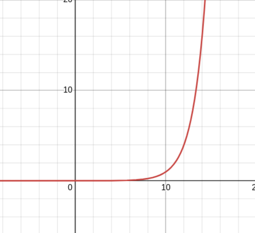

# Functions

Functions are the main method of organizing discrete pieces of computation that have a singular purpose. We use them to break up our code into reusable blocks that can be called and recalled multiple times in the main function or in other programs. This section is going to go a little deeper in depth into the details into using functions in C and proper usage of them to make clean and efficient code. 

## Basic Form and Use of a Function

Whether you remember or not, we have been using functions this entire time. The main function is how C organizes its main program structure. The compiler automatically puts it at the top of the executable by definition.
```c
int main(){
	...
	return 0;
}
```

However, we can create more functions that do different things to make our code cleaner and to make certain parts of our programs more reusable.

This is the general form of a function:
```c
return_type function_name(parameters){
	declarations
	statments
}
```

Let's say we want to compute the average of two numbers many times in a program. By default we do not have an average function in the base C library. So we can make a function that we will declare once and reuse many times in our program. The function would look like this:

```c
double average(double a, double b){
	return (a + b) / 2;
}
```

The first `double` is referring to the return type of the function. If you notice, all of our main functions shown so far have had an `int` before the `main` and always return a 0 at the end of our programs. Much like in this average function, we are defining `main` to output an `int` value (often representing how the program ended normally, 0, or in error, 1). Here the output is a double to capture the precision that an average needs.

After the return type is the function's name, which is how it will be called later in the main function. Within the parentheses are the **parameters** of the function. These are the expected inputs that the function will be called with. Here they represent the two numbers that we will be taking the average of. They need to be typed like all variables, hence the `double` before each. It is important to note that the parameter variable represents **copies** of the input values, not the variables they are getting them from. 

Finally, within the curly braces are the statements that represent what the function will do. Because we have defined an input type, we must have a return statement somewhere within the function's body. Here it is the only statement.

Below is an example of using the average function:

```c
#include <stdio.h>

double average(double a, double b){
	return (a + b) / 2;
}

int main(){
	double x;
	double y;
	double z;

	printf("Please enter three numbers:");
	scanf("%lf%lf%lf", &x, &y, &z);

	printf("Average of %lf and %lf: %lf\n", x,y, average(x,y));
	printf("Average of %lf and %lf: %lf\n", y,z, average(y,z));
	printf("Average of %lf and %lf: %lf\n", x,z, average(x,z));
	
	return 0;
}
```

If we were to read what is going on "under the hood" when we call average(x, y) in the printf()'s, it would look something like this:

1. The average function is called with x and y as arguments.
2. The values stored in x and y are **copied** to variables a and b.
3. average begins execution.
4. The return statement, calculating the average, is evaluated.
5. printf() retrieves the value that is returned by average and prints it.
6. Since average is not stored anywhere, it is forgotten/not saved.

If we wanted to store the average, you could treat the function call as if it were the value it would output given the current inputs:
```c
avg = average(10, 20);
//evaluates to avg = 15.000
```

Functions do not need to take inputs or return outputs, they can be declared with ***void types***, which are a special data type that represent nothing. For example, say we wanted a fancy countdown clock:
```c
#include <stdio.h>

void print_countdown(int n){
	printf("\n+-----------------------------+\n");
	printf("| Warning Countdown Initiated |\n");
	printf("+-----------------------------+\n");
	printf("| Time left: %d ,  and counting|\n", n);
	printf("+-----------------------------+\n");
}

int main(){

	for(int i = 10; i > -1; i--){
		print_countdown(i);
	}
	
	printf("THE THING HAS HAPPENED!\n");

	
	return 0;
}
```

The above function, print_countdown(), takes in an integer but returns nothing, hence the void in the return type spot. 

You can even do this with the parameters/arguments. For example, below is a print out function that will show a program's information, it takes nothing in and returns nothing:

```c
void print_info(void){
	printf("The Something Program\nCreated by Mr. Szwakob\nOn 1/27/25\n");
}
```

!!!! note  void main(void){...} ?
	Yes you can define main with a void return type and parameter types. It is completely up to you, however, for reasons discussed in class, it is nice to know if a program ends normally or in an error. By defining the return type to be int, it gives us that freedom.  As for the parameters, the void is completely optional, as you might have noticed from previous examples. 

### Passing By Value

Before getting a little deeper into how parameters are used within C functions, it is important to make a clear distinction between function **parameters** and function **arguments**. 

**Parameters** refer to the declared input names and types at function creation. They hold no guaranteed value and are used as variables that your function processes.

```c
double average(double a, double b){...}
//             |   Parameters   |

void print_countdown(int n)
//           Parameter ^
```

**Arguments** are the actual values that are given to the function at runtime that hold a value and produce a certain output (if there is one). 

```c
// The function arguments are 10.0 and 30.0
average(10.0, 30.0);

double out, x, y;
x = 100.0;
y = 120.0;
// The function arguments are 100.0 and 120.0
average(x,y);

// the run of the function is given the argument 10, and then is called 
// a second time with 9, a third with 8, and so on.
for(int i = 10; i > -1; i--){
	print_countdown(i);
}
```

It was mentioned that the parameters within a function are given values by copying the inputs values. The makes the **arguments** **pass-by-value** and you can see its behavior if we change the countdown code a little:

```c
#include <stdio.h>
// The loop has been moved to be part of the function, changing
//  the parameter n to mean the number we start from
void print_countdown(int n){
	// Take note that we are using n as the counting variable here
	
	while (n > -1){
		printf("\n+-----------------------------+\n");
		printf("| Warning Countdown Initiated |\n");
		printf("+-----------------------------+\n");
		printf("| Time left: %d ,  and counting|\n", n);
		printf("+-----------------------------+\n");
		
		n--;
	}
}

int main(){

	int countdown_start = 10;

	print_countdown(countdown_start);
	
	printf("Value of count_down_start at end of program:  %d\n", countdown_start);

	return 0;
}
```

Output:
```
...
| Time left: 1 ,  and counting|
+-----------------------------+

+-----------------------------+
| Warning Countdown Initiated |
+-----------------------------+
| Time left: 0 ,  and counting|
+-----------------------------+
Value of count_down_start at end of program:  10
```

Notice that the function now uses the parameter `n` as the countdown variable, decrementing it each iteration. The program also now uses `countdown_start` as the argument, running the function with the value 10. However, when we print `countdown_start` at the end we see that the value never changes.

This is the effect of having arguments that are **pass-by-value**, variables passed into functions are arguments have their values extracted and copied to new variables within the function.

### Declaring variables and Function Scope 

In the general form of a function, I put two statement blocks in the function body, declarations and statements. You can declare variables inside of a function and use them within the function as we have normally been doing. For example, if we wanted to be more verbose with our average function, we could do the following:

```c
double average(double a, double b){
	double sum;
	double avg;
	
	sum = a + b;
	avg = sum / 2;
	
	return avg;
}
```

However, if you tried to access the sum variable from outside of the average function it wouldn't work. Same with the average function trying to access a variable declared in main. This is because the variables declared in a function belong within that function's ***scope***. The scope is where the variable exists and able to be used or manipulated. This is why the input and output types of a function are so important, it is the way we define information passing to and from different parts of a program. 

There are ways to make variables available to all functions in a program, but this could lead to problems down the line. For now, know that variables declared in a function belong to that function. In order to pass information from one function to another you have to plan out what information is really needed for a single purpose. 
## Declaring/Defining Functions

In the previous examples, the function definitions are put at the top of the program. When we are dealing with many functions in a single program you will quickly see that the function definitions build up and end up obfuscating the main function from being viewed and changed quickly:

```c
#include <stdio.h>

void func_1(void){
	printf("I do something!\n");
}

int func_2(int n){
	printf("My input was %d\n", n);
	printf("I am going to return 2 * %d\n", n);
	return 2 * n;
}

char func_3(void){
	printf("I always return money!\n");
	return '$';
}

void func .....
...
...
...
...
...
...
...

void last_func(void){
	printf("Demonstration of many function definitions finished!\n");
}

int main(){
	...
}

```

When you are programming a larger project, your main function acts as the ring leader that is orchestrating your other functions. Because of this you will be doing most of your editing within the main function, leaving it at the top makes for easy access. Luckily, C allows us to put our function definitions anywhere. So, let's try it on the average program:

```c
#include <stdio.h>

int main(){
	double x;
	double y;
	double z;

	printf("Please enter three numbers:");
	scanf("%lf%lf%lf", &x, &y, &z);

	printf("Average of %lf and %lf: %lf\n", x,y, average(x,y));
	printf("Average of %lf and %lf: %lf\n", y,z, average(y,z));
	printf("Average of %lf and %lf: %lf\n", x,z, average(x,z));
	
	return 0;
}

double average(double a, double b){
	return (a + b) / 2;
}
```

Output:

```
[goodguy@magus-turrim ~]$ gcc function_lesson.c 
function_lesson.c: In function 'main':
function_lesson.c:13:54: warning: implicit declaration of function 'average' [-Wimplicit-function-declaration]
   13 |         printf("Average of %lf and %lf: %lf\n", x,y, average(x,y));
      |                                                      ^~~~~~~
function_lesson.c: At top level:
function_lesson.c:20:8: error: conflicting types for 'average'; have 'double(double,  double)'
   20 | double average(double a, double b){
      |        ^~~~~~~
function_lesson.c:13:54: note: previous implicit declaration of 'average' with type 'int()'
   13 |         printf("Average of %lf and %lf: %lf\n", x,y, average(x,y));
      |                                                      ^~~~~~~
[goodguy@magus-turrim ~]
```

Oh no! An error! The reason why is that the computer is sequentially working through the program line by line. Meaning when the main function is being executed, the compiler doesn't know what average function is yet. The compiler makers came up with the idea of an **implicit declaration** of a function when it is being called for the first time. This implicit declaration automatically sets the average function's inputs and outputs to be set at an int by default. In order to remedy this we need a way to tell the compiler what the inputs and outputs of a function will look like while putting the function statements elsewhere in the program. This is the difference between declaring a function and defining a function:

- **Declaring a function**: Letting the compiler know what types your functions parameters and return value will be BEFORE the main function
- **Defining a function:** Dictating what the function will do with it's inputs how the output will be generated AFTER the main function

Usually, C programmers organize it in the following way (using our previous example):
```c
// Include Libraries
#include <stdio.h>

// Declare functions
double average(double a, double b);

// Main Function
int main(){
	double x;
	double y;
	double z;

	printf("Please enter three numbers:");
	scanf("%lf%lf%lf", &x, &y, &z);

	printf("Average of %lf and %lf: %lf\n", x,y, average(x,y));
	printf("Average of %lf and %lf: %lf\n", y,z, average(y,z));
	printf("Average of %lf and %lf: %lf\n", x,z, average(x,z));
	
	return 0;
}

// Function definitions
double average(double a, double b){
	return (a + b) / 2;
}
```

The way the program is read is something like this:

1. Include outside functions, here printf() and all of stdio.h
2. Declare a function named "average" that takes two doubles as parameters and will return a double
3. Begin main function
4. During the execution of main, the function average is called
5. The compiler searches the program for the function definition for average
6. The values x and y are copied to a and b
7. The average is returned
8. Repeat as necessary 
   
The general form for function declarations is:

```c
return_type function_name(para_type para_name, ...);
```

The para_name or parameter names are optional and can be omitted, but when another programmer looks at the top of your code they could read the parameter names and understand your code better.

There are also ways to collect all function declarations and defintions into their own files in order to compile large scale projects with many parts that would benefit being isolated from the rest of the code base. These files are known as **header files** and we will have a lesson on them another day.
## Function Returns

The return keyword is how we define what a function outputs and when it is finished executing. We need to define the return type of the function so the compiler can reserve enough space to read the function's output in to. The function will always return the type defined initially, even if a different type is passed to return. The other type will be cast into the return type:

```c
#include <stdio.h>

int func(double i){
	return i;
}

int main(){

	printf("%d\n", func(4.6));
	//Prints 4
	
	return 0;
}

```

As previously discussed, you can use the return type `void` in order to make the program not need a `return` statement. However, `return` serves a dual purpose. When a function returns an output, the function ignores all statements after the return, giving a method to stop a function early depending on it's inputs. For example:

```c
int print_pos_int(int i){
	if(i < 0)
		return;
	printf("Your int is: %d\n", i);
} 
```

This works for all return types, for example an average function that checks a special condition before doing any math:

```c
double average(double a, double b, double c){
	if(a == b && b == c){
		return a;
	}
	return (a + b + c) / 3.0;
}
```

## Recursion 

Believe it or not, a function can call itself.... I know mind blowing. 

This is called **recursion** and it has some uses. A common use is for calculating the Fibonacci Sequence. The Fibonacci Sequence is a sequence of numbers that is generated from adding the previous two numbers starting with 0, 1:

- 0, 1, 1, 2, 3, 5, 8, 13, 21, 34, 55, ...

This gives the equation: F(n) = F(n - 1) + F(n - 2). This is saying that for any index, n, in the sequence, the value at that index is the sum of the previous two indexes. Leading to the natural direct function:

```c

int fib(int n){
	// Base cases
	if(n < 2)
		return n;

	return fib(n-1) + fib(n-2);
}
```

But be very careful with this function. Sure indexes 0-10 are done with no problem, but start to go past that and your computer will start to slow down the calculation. Depending on the language, recursion can be a way to make fast and efficient programs, but in C you have to find those optimizations yourself. This function is slow because it is running through redundant cases. For example: 

- For n = 5
	- fib(5)
		- return fib(4) + fib(3)
			- fib(4)
				- return fib(3) + fib(2)
					- fib(3)
						- return fib(2) + fib(1)
							- fib(2)
								- return fib(1) + fib(0)
									- fib(1)
										- return 1
									- fib(0)
										- return 0
							- fib(1)
								- return 1
					- fib(2)
						- return fib(1) + fib(0)
							- fib(1)
								- return 1
							- fib(0)
								- return 0
			- fib(3)
				- return fib(2) + fib(1)
					- fib(2)
						- return fib(1) + fib(0)
							- fib(1)
								- return 1
							- fib(0)
								- return 0
					- fib(1)
						- return 1

This is every function call generated from n=5. It just keeps growing from there, in fact the number of operations grows at the rate 2^n which has a graph that looks like this:



Which is why after a certain point the computer starts to just stand still at the higher values of n.

!!!! note Fix Fibonacci
	 Can you see any ways to improve the base nature of this recursive loop? Can you see a better way to do the calculation without so many redundant calls?
