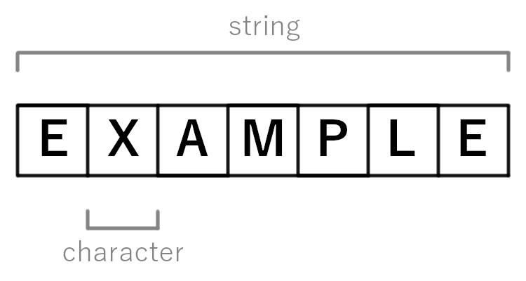
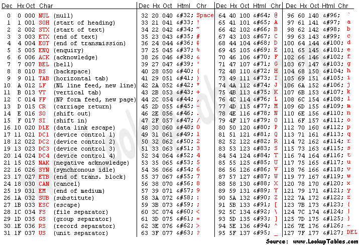
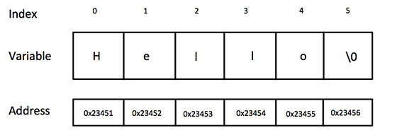

# Strings

Strings are collections of ordered characters that we use to represent a lot of different things. Names, addresses, websites, code, and books all are made of text, having ways of manipulating them makes C very powerful, however with great power, comes great responsibility. There are no guardrails in C and sometimes that leads to headaches, strings are one of the subjects that this becomes apparent in. Pay attention and don't reach for string.h just yet!


## Definition of Strings

A string is a sequence of characters. Names, books, song lyrics, movie scripts, and anything that is represented as text is a string. 



This also includes the empty string, the sequence of nothing, all the way up to sequences of any length. Examples of strings: 

- `"Word"`
- `"This is a sentence and a string."`
- `"1234"`
- `"001245"`
- `"int main(int argc, char* argv[])"`
- `""`
- `"This is a "string" as well"`
- `"~string~"`

You might have noticed that I use double quotes ("") to denote strings, this is pretty common practice and is the same in C.

While many languages implement a string type, C does not out of the box. This is because, under the hood, the string would be stored as an array of character type values, so you might as well just declare it as such:

```c
char string1[] = "HelloWorld!";
char string2[] = "This is my string";
char string2[] = "1234567890!@#$%^&*()";
```

C has put in that the double quotes are read as an array of characters and the variable is sized exactly to store that many characters. This is called a **string literal**, it is the easiest way to declare a string. 

You can also declare empty strings, however you should indicate a maximum size to be safe with your memory (most compilers don't allow an array to be empty with size nothing):

```c
// Good practice
char string[100];
// Not allowed
char bad_string[];
```

Because strings are arrays, you can modify and access the individual characters in the same way:

```c
char string[] = "This is my message."

printf("%s", string);
// Prints "This is my message"

string[6] = 'z';

printf("%s", string);
// Prints "This iz my message"
```

!!! note Single vs Double Quotes 
	You may have noticed that if you use double quotes to define a char or to use as a comparison, you get a warning and/or an error. This is because C uses single quotes to denote a char literal/value. Double quotes are used for string literals/values. While the statements `char c = "C";` and `char c = 'C';` look very much alike, the first is creating an array of characters that contain a single letter C (and something else, explained later), and attempting to store it at a char location. The second is setting c equal to the character C, no array. 
	
	Single Quotes -> Char
	
	Double Quotes -> String

## Loops

This also means that, like normal arrays, loops play a very large role. Below is a "manual" way of printing out a string:

```c
char string[] = "tenletters";

for(int i = 0; i < 10; i++){
	putchar(string[i]);
}
```
Like normal arrays, you cannot do direct operations or comparisons on strings. Meaning anything like `if(string1 == string2)` cannot be done out of the box. It also means that you need to apply those functionalities in functions that operation on a by-element level. 
This is all C out-of-the box, there is a string.h library, but at first I want you to do your own functions first to know what is going on.

## Sizeof()

Another thing that carries over from arrays is the ability to find the size of a string using sizeof():

```c
#include <stdio.h>

void main(void){

	char string[] = "tenletters";

	int size = sizeof(string) / sizeof(char);

	printf("Length of string: %d\n", size);
}
```

Outputs:

```
szwakoj@dkl-coe-f749:~$ ./a.out
Length of string: 11
szwakoj@dkl-coe-f749:~$
```

## NULL Terminator

But wait! `"tenletters"` has 10 letters in it! What is going on? Lets run another program to see if we can see what's happening:

```c
#include <stdio.h>

void main(void){

	char string[] = "";

	int size = sizeof(string) / sizeof(char);

	printf("Length of string: %d\n", size);
}
```

Outputs:

```
szwakoj@dkl-coe-f749:~$ ./a.out
Length of string: 1
szwakoj@dkl-coe-f749:~$
```

Even with a seemingly empty string there is an extra character there. If we tried 
`printf("%c", string[0]);` nothing would print to the console, but if you used `%d` to see the decimal representation of the first element you would get 0. 

```c
#include <stdio.h>

void main(void){

	char string[] = "";

	int size = sizeof(string) / sizeof(char);

	printf("Length of string: %d\n", size);
	printf("Character number at index 0: %d\n", string[0]);
}
```

Outputs:

```
szwakoj@dkl-coe-f749:~$ ./a.out
Length of string: 1
Character number at index 0: 0
szwakoj@dkl-coe-f749:~$
```

Let's take a look at our handy-dandy ASCII Table:



The first entry is 0, and if you look at what character it is you will see NUL/NULL, (null), or as a character specifier: `'\0'`.  

NULL means nothing, it is used to denote that nothing exists. It is not 0 itself, because 0 is a value, NULL on the other hand signifies the absence of value. But what is it doing in every single string we create?

Because functions and programs need to be able to work with any length string, there needs to be a way that programmers can definitively say a string has ended. Strings are different from normal character arrays because they will always end in a `'\0'` character, called the **NULL terminator**. 

```c
// These are equivalent 
char string1[] = "string";
char string2[] = {'s','t','r','i','n','g','\0'};
```



By using the NULL terminator, any function can search for the NULL terminator and then know the length, or if they don't even need the length, can do their operations on every character until they reach a NULL terminator. 

For example:

```C
#include <stdio.h>

void print_capitalize(char in_string[]){
	
	// Notice how I am not checking any bounds or need to pass
	// any extra parameters, I can reliably know that my string
	// will be read properly, so long as it is formatted as a 
	// string...
	for(int i = 0; in_string[i] != '\0'; i++){

		// If this part confuses you, take a look at the
		// above table and see why I am doing it
		if(in_string[i] >= 'a' && in_string[i] <= 'z'){
			printf("%c", in_string[i] - 32);
		} else {
			printf("%c", in_string[i]);
		}
		
	}
}

void main(void){

	// Note: the strings are refering to the length of the string
	// not including the '\0', NULL terminator
	char string1[] = "tenletters";
	char string2[] = "$fifteen chars$";

	print_capitalize(string1);
	// Prints "TENLETTERS"
	printf("\n");
	print_capitalize(string2);
	// Prints "$FIFTEEN CHARS$"
	printf("\n");
}
```

The comment explain everything, but to reiterate, both string1 and string2 are strings of a set size, 10 and 15 respectively, however when declared literally using double quotes ("") C adds a `'\0'` character at the end, making them 11 and 16. This is difficult to track all of the time, add into the fact that you never know what string the user will give, and having a way of saying where the end of a string is without knowing the size becomes very useful.

The definition of a string in C is that it is a character array that ends in a `'\0'`, but his may not always be the case. However since that is the definition of a string in the C Standard, all functions using strings assume that the input will be a character array that will end in a NULL terminator. If your string doesn't have the NULL terminator at the end or it has a NULL terminator in the middle, weird behaviors can happen.
Below is another main function using the print_capitalize() function, notice that I have changed the definition of string2. Instead of a space the string now has a `'\0'` character as the divider. 

```c
#include <stdio.h>

void print_capitalize(char in_string[]){
	
	// Notice how I am not checking any bounds or need to pass
	// any extra parameters, I can reliably know that my string
	// will be read properly, so long as it is formatted as a 
	// string...
	for(int i = 0; in_string[i] != '\0'; i++){

		// If this part confuses you, take a look at the
		// above table and see why I am doing it
		if(in_string[i] >= 'a' && in_string[i] <= 'z'){
			printf("%c", in_string[i] - 32);
		} else {
			printf("%c", in_string[i]);
		}
		
	}
}

void main(void){

	// Note: the strings are refering to the length of the string
	// not including the '\0', NULL terminator
	char string1[] = "tenletters";
	char string2[] = "$fifteen\0chars$";

	printf("%s\n", string1);
	// Prints "tenletters"
	printf("%s\n", string2);
	// Prints "$fifteen"

	print_capitalize(string1);
	// Prints "TENLETTERS"
	printf("\n");
	print_capitalize(string2);
	// Prints "$FIFTEEN"
	printf("\n");

	printf("Size of string 1 = %d\n", sizeof(string1) / sizeof(string1[0]));
	// Prints 11
	printf("Size of string 2 = %d\n", sizeof(string2) / sizeof(string2[0]));
	// Prints 16
}
```

Notice that even our trusty old printf() obeys the almighty NULL terminator. The way that print_capitalize() is written, is essentially how most string functions work, you trust the input will have a NULL terminator and your operate on it until you find it. Due to the C Standard picking the string definition as such, the responsibility of making sure you do not go to parts of the string that do not exist is on the person giving your function the string. In the event that a string doesn't have any NULL terminators, there will be errors. I would show an example of one, but modern compilers have a lot of guardrails that will spot that undefined behavior before anything happens. 

## String I/O
String output is easy for the most part, printf()'s `'%s'` format specifier takes care of most situations just fine:

```c
#include <stdio.h>

void main(void){
	char string1[] = "string";
	char string2[] = "This is a string";
	char string3[] = "\nstring\non\nfour\nlines\n";

	printf("%s\n", string1);
	printf("%s\n", string2);
	printf("%s\n", string3);
}
```

string3 even shows that you can use the `'\n'` newline escape character in your strings, same with the rest of them, like tab `'\t'`. 

However, inputting strings isn't so easy because of the requirement that strings must end in a NULL terminator. If you try to use scanf() normally you might not notice an issue right away:

```c
#include <stdio.h>

void main(void){
	char input[100];

	scanf("%s", input);

	printf("The string was: %s\n", input);
}
```

Output:

```
szwakoj@dkl-coe-f749:~$ ./a.out 

HelloWorld!                    
The string was: HelloWorld!

szwakoj@dkl-coe-f749:~$ ./a.out 

LoooooooooooooooooooooooooooooooooooooooooooooongString
The string was: LoooooooooooooooooooooooooooooooooooooooooooooongString

szwakoj@dkl-coe-f749:~$ ./a.out 

This is a sentence
The string was: This
```

Notice that the scanf() works for simple cases, but for anything with spaces it doesn't work. This is because scanf() takes input from the console, but in the case of strings, it doesn't know how many characters it will be. When you press "ENTER"  to send the input into the program, it adds a newline since "ENTER" automatically represents that character when you type. Newline is a type of white-space, and to be safe scanf() treats all white space as if it is a NULL terminator and stops taking in characters at the space since it is a type of white-space as well. 

A better way to get strings from the user is to use another function from stdio.h. fgets() or "file get string" is a another input reading function. This one behaves in a little bit of a different way from the usual scanf().

https://www.tutorialspoint.com/c_standard_library/c_function_gets.htm

This link will take you to a page that explains it in detail, but to summarize:
fgets() takes in an empty string, the number of characters to be read, and the source of the character input, like so:

- `fgets(char destination_string[], int num_chars, stdin)`

That `stdin` means "standard input" which is a variable given in stdio.h that, by default, represents the console input field. 

Example:

```c
#include <stdio.h>

void main(void){
	char input[100];

	// I am reading in 100 characters as a maximum, but
	// fgets knows that at the end of the user input it 
	// adds a '\0' to make it a valid string. If the user
	// goes over, fgets reads in 99 characters and then
	// a '\0' to make sure everything is stored correctly
	fgets(input, 100, stdin);

	printf("The string was: %s\n", input);
}
```

Output:

```
szwakoj@dkl-coe-f749:~$ ./a.out 
This is a sentence
The string was: This is a sentence

szwakoj@dkl-coe-f749:~$
```

As the comment explains, the second parameter is the maximum number number of chars able to be stored in the destination string, not necessarily the number it is expecting. This makes sure you can set your maximum number of characters and not go over your array limit.