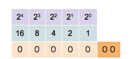
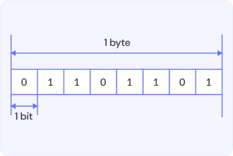
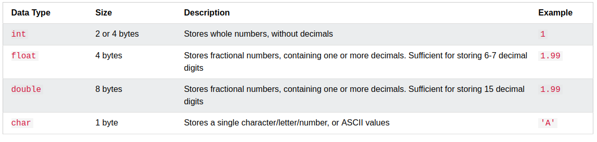

# Pointers

Everything we have learned up until now is enough for most purposes for basic usage of C. The basic data types, arrays, and strings can solve most simple problems, however the power of C comes from the full control over the data we are working with. For example, we control the initial size of an array and work around it, but what if we wanted to store more than the max? Should we just set that limit and never have the option to go bigger? Should the same program with, say a 100 sized array, take up those 100 spots of memory for a user that uses only 3 spots of the array? From what we have gone over so far, we would only be able to work within a pre-determined amount of memory, no more or less. It would be extremely useful to be able to allocate and de-allocate memory as needed and refer to arbitrary length data types. This is where memory management and pointers come in.

## Basics of how data is stored in C

We haven't gotten too deep into the details about how memory is actually stored in C. Things like, how do values get attached to variables, how much space a program used to store all the variables, and others have been swept under the rug. This is mostly to get the basics down before doing some deep C diving, and confusing the uninitiated before learning general programming principles. 

Recall all the way back to Basics of Computers, and that all information in a computer is stored as 1's and 0's in a base-2 number system called binary. Here is a counter that shows how binary looks and how it is represented:



Each binary digit is called a **bit** (**BI**nary dig**IT**) and takes a single unit to represent. That unit can be a transistor (in the case of CPU/GPU memory, RAM, and SSDs), sections of a magnetic material (in the case of HDDs and cassette tapes), or anything that can represent two states, on or off. Because it is a base-2 system it makes sense to group bits into lengths that match up with the values at each multiple of the base (like 10, 100, and 1000 in base-10 and the metric system, it is convenient to work with numbers that align with the bases). Leading to the construction of a byte, 8 bits used to represent a number from 0-255:



00000000 is 0 and 11111111 is 255 if we only want positive numbers. If we wanted negative numbers, we could use the last bit (all the way to the left) to represent the existence of a negative number:

- 000000001 = 1
- 100000001 = -1
- 01111111111 = 127
- 11111111111 = -127

As you can see if we want negative numbers the maximum number we can represent goes down but allows for negative numbers. If you take a second and look, you will notice that both signed and unsigned single byte ranges contain the same number of possible values:

- 0-255 = 256 values; 
- -128 - 0 = 128 values, 1 - 128 = 127 values = 256 total values, but there is also -0 which is overrided to be -128
- 
More on this later, but as you can see there is a limit on the number of values that can be represented using a set number of memory locations. 

In C, the smallest unit used to represent most common data types is the byte (8 bits). You may recall seeing the memory sizes in The Basics of C when looking at the basics data types: 




To reiterate and provide the limits of all the data types:

- char - character (1 byte)
	- Unsigned range = 0 - 255
	- Signed range = -128 - 127
	- Used to represent characters, but is a normal integer type under the hood
	- char itself can represent either signed or unsigned values by default depending on the compiler, unlike other int types which by default are signed
- int - integer (2 or 4 bytes)
	- 2 Byte Range = -32,768 - 32,767
	- 4 Byte Range = -2,147,483,648 - 2,147,483,647
	- The reason for the two possibilities is that there isn't a full definition for an int in The C Standard (they just set a minimum number of bits that is needed to be defined as an integer)
	- So depending on the compiler, system, and OS it may be 2 or 4 bytes, but that doesn't matter since there are extensions to the basic types that give more control
- float - floating point number (4 bytes)
	- Range = 1.2 E -38 to 3.4 E 38 
	- There is a notion of precision in programming languages, which is outside the scope of fundamentals, but basically floats can store numbers to full accuracy to only 6 decimal places 
- double - double precision floating point (8 bytes)
	- 2.3 E -308 - 1.7 E 308
	- 15 decimal places of precision

Each variable storing each data type takes up exactly that amount of spaces on the computer. We can check this directly using `sizeof()`:

```c
#include <stdio.h>

int main(void){
	int var = 10;

	printf("Size of var: %d bytes!\n", sizeof(var));
	// Prints : Size of var: 4 bytes!
	// You can even use the data type directly
	printf("Size of int: %d bytes!\n", sizeof(int));
	// Prints : Size of int: 4 bytes!

	return 0;
}
```

!!! note "sizeof(everything)"
	The sizeof() function will simply tell you the amount of space something takes up in bytes. This works for everything, floats, variables, arrays, strings, anything! Maybe even functions.... Try it out on anything you can try it on, experiment!

So information takes up space, that's all well and good, but how is it referenced? Like, how do we know what bits `var` contains. Or the reverse, on the RAM stick where the bits of the number 10 is stored, how do we know those bits are `var` and not some other variable.

In C, variables are stored in a similar way to this:

| Data Location | 0x000 | 0x001 | 0x002 | 0x003 | 0x004 | 0x005 | 0x006 |
| ------------- | ----- | ----- | ----- | ----- | ----- | ----- | ----- |
| Data Value    | 255   | 231   | 23    | -36   | 10    | 0     | 1     |
| Name          | n/a   | n/a   | n/a   | n/a   | var   | n/a   | n/a   |

Where values are stored at known addresses in memory, here represented using numbers with a 0x before it. Each memory location refers to a location of 1 byte, so we can assume that each data value+location refers 1 byte of information (this is for purposes of demonstration, the real process and scheme is a little more complex but follows the same ideas). 

The variable `var` has two components, the value that is stored within `var` and the location that it is stored. We have been using the address of variables from the very beginning. `scanf()` requires to be given the address of the variable that is to be filled with user information. When we do something like `scanf("%d", &var);`, we are using the & operator to get the address of the variable. 

We can see this dual nature of variables in this snippet:

```c
int var = 10;

// Prints the value var
printf("%d\n", var);
// Prints the address of var
printf("%p\n", &var);
```

Here, I use the `&` operator on `var`, this returns the address that var is referring to. I also use the `%p` format specifier to print the address. It is `%p` because addresses are referred to as pointers in C, more on this in a bit.

You can think of it like a house where:

- The house represents the physical location of memory
	- In the case of a char variable house, it takes of 1 byte of square-footage
- The family inside represents the data value "living" in the bytes on the computer
	- An int family needs to have a house with either 2 or 4 bytes of square-footage
- The address of the house is the data location
	- If you were sending a new family to an empty house, you would give them the address of the house so they can find it

Arrays work vary similarly, say we have `char array[5] = {1, 2, 3, 4, 5};`:

| Data Location | 0x000 | 0x001      | 0x002      | 0x003     | 0x004      | 0x005      | 0x006 |
| ------------- | ----- | ---------- | ---------- | --------- | ---------- | ---------- | ----- |
| Data Value    | 255   | 1          | 2          | 3         | 4          | 5          | 102   |
| Name          | n/a   | array\[0\] | array\[1\] | array\[2] | array\[3\] | array\[4\] | n/a   |

As you can see there is no storage of an "array" variable, instead each entry of the array is stored. This is why you can't treat using `array` like a normal variable. `array` doesn't contain a value itself, instead `array[i]`, where `i` is the index , refers to the individual elements of the array. 

In the housing analogy, an array would be like an apartment building. Where the building has a singular address, but if you wanted to send a mail to the tenant on floor 3, you would send it to the address of the building but specify what floor the person/family you want to interact with is on. Usually, if you send mail to the building without putting the floor number it will be delivered to the first floor, this is the same for arrays when we treat them like pointers. 

## Pointers

In the previous section, we went over how memory works in C. Specifically, how variables are stored and referenced, revealing that variables contain three parts:

- **The value** that the variable currently holds
- **The address** where the variable "points" to in order to retrieve that value
- **The identifier** we use to reference it in our code

The address is what really dictates what the variable is referring to because the value can change, but the address needs to remain the same so that we can keep track of the same value.

In C, we can make variables that store the address of a piece of memory, this data type that stores an address is called a **pointer**. This is because it "points" to a piece of memory, not the value stored itself. 

In the previous section, we showed this address using the `&` operator. This operator will return the address of whatever is after the operator. This address is a pointer to the memory location where a variable gets its value from. For example:

```c
#include <stdio.h>

int main(void){
	int var = 12345;

	printf("The value of var: %d\n", var);
	printf("The address of var: %p\n", &var);

	return 0;
}
```

The above, like before, will print both the value of `var` and the address where `var` draws it's value from. Let's continue.

In order to declare a pointer variable, you need to know what the pointer is pointing to, as in the datatype that the address is pointing to. You used the `*` to dictate that the value being stored in `ptr` is a pointer. For example:  

- `int* ptr = &var;`
- Read from left to right:
	- "I am declaring an integer pointer, named ptr, that is initialized to be the address of the variable var"
- `char* ptr;`
- Read from left to right:
	- "I am declaring a character pointer, named ptr, that is not initialized to a starting value"

This is a continuation of the previous:

```c
#include <stdio.h>

int main(void){
	int var = 12345;
	int* ptr = &var;

	printf("The value of var: %d\n", var);
	printf("The address of var: %p\n", &var);
	
	printf("The value of ptr: %p\n", ptr);
	printf("The address of ptr: %p\n", &ptr);

	return 0;
}
```

Output:

```
The address of var: 0x7ffc27004e9c
The value of ptr: 0x7ffc27004e9c
The address of ptr: 0x7ffc27004ea0
```

Now I am storing the address of `var` in the variable `ptr`. `ptr` is an integer pointer, meaning it will store the address of an int value. You can see that `ptr` itself stores the address of `var`, not the value the var contains. You can also see that `ptr` has its own address as well. 

We can access and interact with the value stored at a pointer location using the `*` operator:

```c
#include <stdio.h>

int main(void){
	int var = 12345;
	int* ptr = &var;

	printf("The value of var: %d\n", var);
	printf("The value of *ptr: %d\n", *ptr);

	// Adding 1 to *ptr
	*ptr += 1;

	printf("The value of var: %d\n", var);
	printf("The value of *ptr: %d\n", *ptr);

	return 0;
}
```

Output:

```
The value of var: 12345
The value of *ptr: 12345
The value of var: 12346
The value of *ptr: 12346
```

Notice that var is never changed directly, we are only ever interacting with the pointer to it. 

Using `*` to access the value of a pointer, is called dereferencing. This is because a pointer is a reference to a piece of memory, without a regard with what is stored there. Dereferencing acts to "collapse" the address into the actual value being stored there.

To recap:

- We declare pointers like this:
	- `datatype* name;`
	- Examples: 
		- `int* int_ptr;`
		- `char* char_ptr = &other_var;`
- We can get the address/pointer of a variable by using the `&` operator:
	- `int* ptr = &var;`
- We can get the value stored at a pointer/address by using the `*` operator to de-reference it:
	- `printf("ptr holds the value: %d", *ptr);`

## Arrays and Pointers

Arrays and pointers are very much related. 

Let's start a simple program with an array of ints and loop through it to print them out:

```c
#include <stdio.h>

int main(void){
	int array[] = {12, 36, 68, 26, 17};

	for(int i = 0; i < 5; i++){
		printf("%d\n", array[i]);
	}

	return 0;
}
```

The thing about arrays is that the variable name `array` is actually a pointer to the first element of the array. Before diving into the implications of this, let's prove it first. Here, I am printing out the address of each element of the array instead of its value, I also print out the value of `array` with no index:

```c
#include <stdio.h>

int main(void){
	int array[] = {12, 36, 68, 26, 17};

	for(int i = 0; i < 5; i++){
		printf("Address of array[%d]:\t %p\n", i, &array[i]);
	}
	
	printf("Value of array:\t %p\n", array);
	
	return 0;
}
```

Output:

```
Address of array[0]:	 0x7fffc55bc240
Address of array[1]:	 0x7fffc55bc244
Address of array[2]:	 0x7fffc55bc248
Address of array[3]:	 0x7fffc55bc24c
Address of array[4]:	 0x7fffc55bc250
Value of array:			 0x7fffc55bc240
```

If you look closely, you can see that `&array[0]` and `array`, both hold the same value. This confirms that the variable `array` is a pointer to the first element of the array. This also means that we can treat it like one:

```c
#include <stdio.h>

int main(void){
	int array[] = {12, 36, 68, 26, 17};

	printf("Dereferenced *array: %d\n", *array);
	
	return 0;
}
```

Outputs:

```
Dereferenced *array: 12
```

Because it is a pointer, I can dereference it to get the value stored there. We can also add to the array to get different elements of the array:

```c
#include <stdio.h>

int main(void){
	int array[] = {12, 36, 68, 26, 17};

	for(int i = 0; i < 5; i++){
		printf("Value of *(array + %d): %d\n", i, *(array + i));
	}
	
	return 0;
}
```

Outputs:

```
Value of *(array + 0): 12
Value of *(array + 1): 36
Value of *(array + 2): 68
Value of *(array + 3): 26
Value of *(array + 4): 17
```

In this code I am adding to the `array` variable to change where it is pointing to, but I can also change the values stored at each index:

```c
#include <stdio.h>

int main(void){
	int array[] = {12, 36, 68, 26, 17};

	printf("===Before===\n");
	for(int i = 0; i < 5; i++){
		printf("array[%d]: %d\n", i, array[i]);
	}
	// Setting first element to 10
	*(array + 0) = 10;

	// Setting third element to 68 + 32
	*(array + 2) += 32;

	// Setting fifth element to 1000
	*(array + 4) = 1000;
	
	printf("===After===\n");
	for(int i = 0; i < 5; i++){
		printf("array[%d]: %d\n", i, array[i]);
	}
	return 0;
}
```

Outputs:

```
===Before===
array[0]: 12
array[1]: 36
array[2]: 68
array[3]: 26
array[4]: 17
===After===
array[0]: 10
array[1]: 36
array[2]: 100
array[3]: 26
array[4]: 1000
```

As you can see, you can add to either the pointer, the value inside of it, or both:

- `*(array + 2) == array[2]`
- `*array + 10 == array[0] + 10`
- `*(array + 4) + 10 == array[4] + 10`

Another consequence of this, is that we can copy the array pointer and do some cool things with it:

```c
#include <stdio.h>

void function(int* in_ptr){
	// Sets the value stored in in_ptr to 999
	*in_ptr = 999;
}

int main(void){
	int array[] = {12, 36, 68, 26, 17};

	// Create copy of array pointer
	int* ptr = array;

	// Iterate using the pointer
	for(int i = 0; i < 5; i++){
		printf("%d\n", *(ptr + i));
	}

	// Always have access to an element, regardless of changes
	// This makes the pointer point to the element 2
	ptr = ptr + 2;

	printf("*ptr = %d\n", *ptr);
	// Prints 68

	// Changes element 2 to 100
	array[2] = 100;

	printf("*ptr = %d\n", *ptr);
	// Prints 100
	
	// Pass single elements into functions for alteration
	// This will change array[2] to 999 using function()
	function(ptr);

	printf("array[2] = %d\n", array[2]);
	// Prints 999

	return 0;
}
```
## Example Uses

The main benefit to using pointers is that we can now pass variables into functions by reference and not by value. You see, when we attempted to do something like this:

```c
#include <stdio.h>

void function(int x){
	x = 10;
}

int main(void){
	int var = 0;

	function(var);

	printf("%d\n", var);
	// Prints 0

	return 0;
}
```

Nothing happens to `var`. This is because C always passes values to functions by copying the value stored in the variable and creating a local version of it inside the function scope. This is called passing function parameters by value. If we were able to alter var from within the function, it is called passing function parameters by reference because the inputs are references to variables stored outside the function. 

A simple example where we may run into headaches is wanting to swap the values of two variables by using a function:

```c
#include <stdio.h>

void swap_func(int* a, int* b){
	int temp = *a;
	*a = *b;
	*b = temp;
}

int main(void){
	int var1 = 10;
	int var2 = 100000;

	swap_func(&var1, &var2);

	printf("var1 = %d\n", var1);
	printf("var2 = %d\n", var2);

	return 0;
}
```

Without pointers this is impossible to do with a function.

Pointers especially come in handy when dealing with strings. This is because they can be any length and, because they are arrays, require operations to be done element-by-element.

Below is an example of a string copy function:

```C
#include <stdio.h>

void string_copy(char* dest, char* source){
	// While the pointer is pointing to something that
	// isn't the NULL terminator...
	while(*source != '\0'){
		// Set the value that the current pointer is 
		// pointing to equal to the value that source
		// is currently pointing to
		*dest = *source;

		// Increment both pointers so that they are 
		// pointing to the next letter
		dest++;
		source++;
	}

	// Clean up string to make sure it ends in \0
	*dest = '\0';
}

int main(void){
	char str_origin[] = "This is the first string!";
	char empty_str[100];

	// This will not work:
	// empty_str = str_origin;
	
	// Hence the need for a function
	string_copy(empty_str, str_origin);

	printf("%s\n", str_origin);
	printf("%s\n", empty_str);

	return 0;
}
```


